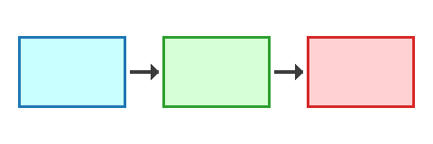

# Co je programovací agent

Programovací agent je nástroj, který na základě vašeho zadání (**promptu**) čte soubory,
navrhuje změny a spouští příkazy v terminálu. Vy zůstáváte u řízení: zadáváte cíl,
kontrolujete výsledek a rozhodujete, co se uloží.

Typický pracovní postup má tři kroky:

1. **Zadání** — popíšete, čeho chcete dosáhnout.
2. **Práce agenta** — agent navrhne a provede změny.
3. **Ověření** — zkontrolujete, že výsledek opravdu funguje.

> Příliš žluťoučký kůň úpěl ďábelské ódy. Diakritika se musí zobrazit správně.
